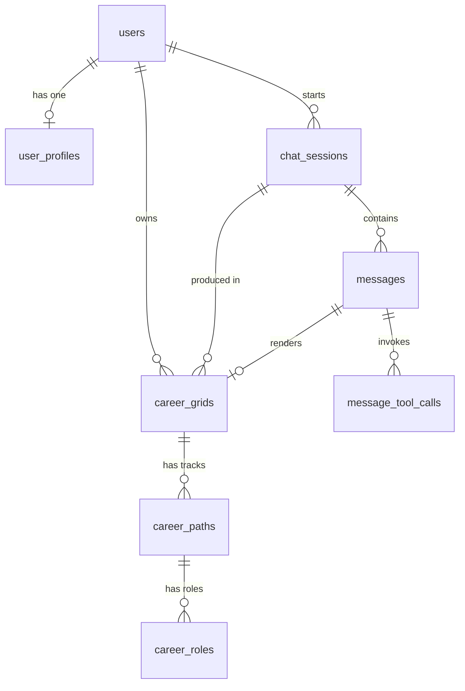

# CareerCompass — Database Schema

**Status:** DRAFT for review — nothing implemented yet
**Target:** PostgreSQL 15+
**Scope:** (1) user ↔ CareerCompass chat sessions, (2) user profile data

> This is the design step. Once you approve the tables below, we generate the
> models/migrations for the ORM you pick. The DDL in §5 is real, runnable
> Postgres — it's the source of truth the ORM models must match.

---

## 1. What we're storing

Your two requirements plus what the existing app already produces:

| # | Requirement | Tables |
|---|---|---|
| 1 | **Chat sessions with CareerCompass** | `chat_sessions`, `messages`, `message_tool_calls` |
| 2 | **User data** — name, picture, DOB, current role/education, address | `users`, `user_profiles` |
| 3 | *Already produced by the app, currently thrown away on refresh* | `career_grids`, `career_paths`, `career_roles` |

Item 3 matters: today the career grid lives only in React state
(`Message.gridData`). Refresh the page and the user's recommendations are gone.
It is the app's main output, so I've given it real tables rather than a blob —
see decision **D2**.

---

## 2. Entity relationships



Cardinality notes:

* **1:1** `users` → `user_profiles` (split for the reason in D1).
* **1:N** `chat_sessions` → `messages` — a session is one conversation.
* **1:N** `messages` → `message_tool_calls` — one assistant turn can call
  several tools in a single round (the loop in `lib/ollama.ts` fans out).
* **1:1** `messages` → `career_grids` — a turn either builds a grid or doesn't.
* **1:N:1** `career_grids` → `career_paths` → `career_roles` — mirrors
  `CareerGridData` in `lib/types/career.ts` exactly.

---

## 3. Tables at a glance

| Table | Rows mean | Grows with |
|---|---|---|
| `users` | an account | signups |
| `user_profiles` | that person's personal + intake data | signups |
| `chat_sessions` | one conversation thread | every "New chat" |
| `messages` | one turn (user or assistant) | every message |
| `message_tool_calls` | one tool the model invoked | every search / grid call |
| `career_grids` | one career map shown to the user | every full recommendation |
| `career_paths` | one track in that map | 3–5 per grid |
| `career_roles` | one role in that track | 3 per path |

---

## 4. Column specifications

### 4.1 `users` — identity & login

Only what's needed to authenticate. Personal data lives in `user_profiles`.

| Column | Type | Null | Notes |
|---|---|---|---|
| `id` | `uuid` | no | PK, `gen_random_uuid()` |
| `email` | `text` | no | unique, **stored lowercased** (see D6) |
| `password_hash` | `text` | yes | null = OAuth-only account (bcrypt/argon2) |
| `email_verified_at` | `timestamptz` | yes | null = unverified |
| `created_at` | `timestamptz` | no | `now()` |
| `updated_at` | `timestamptz` | no | `now()`, bumped by trigger |
| `last_login_at` | `timestamptz` | yes | |
| `deleted_at` | `timestamptz` | yes | soft delete; null = active |

### 4.2 `user_profiles` — the data you listed

1:1 with `users`; the row is created empty at signup and filled in as the
guided intake runs (the app asks one question at a time, so most columns are
nullable by design).

| Column | Type | Null | Notes |
|---|---|---|---|
| `user_id` | `uuid` | no | PK **and** FK → `users.id`, cascade |
| `display_name` | `text` | yes | "Profile name" |
| `avatar_url` | `text` | yes | "Profile picture" — see D4 |
| `date_of_birth` | `date` | yes | "date of birth" — age is derived, never stored |
| `current_status` | `text` | yes | `student` / `working` / `between` / `other` — "Current Working role or education" |
| `current_role_title` | `text` | yes | e.g. "Junior Data Analyst" |
| `current_employer` | `text` | yes | |
| `education_level` | `text` | yes | `school` / `high_school` / `undergrad` / `postgrad` / `doctorate` / `other` |
| `field_of_study` | `text` | yes | e.g. "Computer Science" |
| `country_code` | `char(2)` | yes | ISO 3166-1 — drives salary region + currency |
| `region` | `text` | yes | state / province |
| `city` | `text` | yes | |
| `postal_code` | `text` | yes | |
| `timezone` | `text` | yes | IANA, e.g. `Asia/Kolkata` |
| `currency` | `char(3)` | yes | ISO 4217 — what salaries are shown in |
| `interests` | `text[]` | no | intake Q2, e.g. `{coding,biology}` |
| `hobbies` | `text[]` | no | intake Q3 |
| `work_style` | `text[]` | no | intake Q4, e.g. `{analytical,remote}` |
| `constraints` | `text[]` | no | intake Q5, e.g. `{budget:low,no_relocation}` |
| `onboarding_completed_at` | `timestamptz` | yes | null = still in guided intake |
| `created_at` / `updated_at` | `timestamptz` | no | |

### 4.3 `chat_sessions` — "Sessions of user with Career_AI"

| Column | Type | Null | Notes |
|---|---|---|---|
| `id` | `uuid` | no | PK — also sent to the client |
| `user_id` | `uuid` | **yes** | FK → `users.id`, cascade. Null = anonymous chat (D3) |
| `anon_id` | `text` | yes | browser id, so anonymous chats survive and can be claimed at signup |
| `title` | `text` | yes | auto-set from the first user message |
| `model` | `text` | yes | e.g. `gemma4:31b` — which model answered |
| `status` | `text` | no | `active` / `archived`, default `active` |
| `message_count` | `integer` | no | denormalized for the sidebar list, default 0 |
| `created_at` | `timestamptz` | no | |
| `updated_at` | `timestamptz` | no | |
| `last_message_at` | `timestamptz` | yes | sort key for "Recent chats" |

Constraint: exactly one of `user_id` / `anon_id` may be null — but not both.

### 4.4 `messages` — one turn

| Column | Type | Null | Notes |
|---|---|---|---|
| `id` | `uuid` | no | PK |
| `session_id` | `uuid` | no | FK → `chat_sessions.id`, cascade |
| `seq` | `integer` | no | 1,2,3… within the session. **Ordering key** — see D5 |
| `role` | `text` | no | `user` / `assistant` / `system` / `tool` |
| `content` | `text` | no | default `''`; an assistant turn may be tools-only |
| `prompt_tokens` | `integer` | yes | from Ollama's `prompt_eval_count` |
| `completion_tokens` | `integer` | yes | from `eval_count` |
| `duration_ms` | `integer` | yes | wall-clock for the turn |
| `error` | `text` | yes | set if the turn failed mid-stream |
| `created_at` | `timestamptz` | no | |

Unique on `(session_id, seq)`.

> Only the **finished** turn is written. Streaming tokens are not persisted —
> the route writes once when `generateRecommendation` resolves.

### 4.5 `message_tool_calls` — tools the model invoked

Matches `ToolCallInfo` in `lib/types.ts` (which the UI already renders as
badges).

| Column | Type | Null | Notes |
|---|---|---|---|
| `id` | `uuid` | no | PK |
| `message_id` | `uuid` | no | FK → `messages.id`, cascade |
| `call_id` | `text` | no | the signature from `lib/ollama.ts` (name + args) |
| `name` | `text` | no | `web_search` / `web_fetch` / `start_career_grid` / `add_career_path` |
| `arguments` | `jsonb` | no | shape varies per tool → **jsonb**, not columns |
| `result_summary` | `text` | yes | e.g. "Read 3 pages · 3 sources summarized" |
| `ok` | `boolean` | no | default true |
| `duration_ms` | `integer` | yes | |
| `position` | `integer` | no | order within the message |
| `created_at` | `timestamptz` | no | |

### 4.6 `career_grids` → `career_paths` → `career_roles`

This is `CareerGridData` normalised:

```ts
// lib/types/career.ts  →  database
CareerGridData        →  career_grids  (+ career_paths via FK)
  .title              →  career_grids.title
  .startingPoint      →  career_grids.starting_label / starting_description
  .paths[]            →  career_paths
    .pathName         →  career_paths.name
    .recommended      →  career_paths.recommended
    .roles[]          →  career_roles
```

**`career_grids`**

| Column | Type | Null | Notes |
|---|---|---|---|
| `id` | `uuid` | no | PK — **reuse as the SSE `gridId`** already sent to the browser |
| `session_id` | `uuid` | no | FK → `chat_sessions.id`, cascade |
| `message_id` | `uuid` | yes | FK → `messages.id`, the turn that drew it |
| `user_id` | `uuid` | yes | FK → `users.id`, cascade (null for anonymous) |
| `title` | `text` | no | |
| `starting_label` | `text` | no | |
| `starting_description` | `text` | no | |
| `created_at` | `timestamptz` | no | |

**`career_paths`**

| Column | Type | Null | Notes |
|---|---|---|---|
| `id` | `uuid` | no | PK |
| `grid_id` | `uuid` | no | FK → `career_grids.id`, cascade |
| `name` | `text` | no | |
| `recommended` | `boolean` | no | default false — exactly one true per grid |
| `position` | `integer` | no | column order in the UI |

**`career_roles`**

| Column | Type | Null | Notes |
|---|---|---|---|
| `id` | `uuid` | no | PK |
| `path_id` | `uuid` | no | FK → `career_paths.id`, cascade |
| `position` | `integer` | no | 0 = entry-level |
| `title` | `text` | no | |
| `years_from_start` | `text` | no | kept as text — the model returns "0-1 years" |
| `salary_range` | `text` | no | kept as text — "₹4-8 LPA", "$50K-$75K" |
| `skills` | `text[]` | no | default `{}` |
| `description` | `text` | no | |
| `entry_path` | `text` | no | |
| `outlook` | `text` | no | |

> `salary_range` and `years_from_start` stay **text** on purpose: the model
> writes human ranges, and parsing them into min/max integers is a lossy
> guess. If you later want salary analytics, add nullable
> `salary_min`/`salary_max`/`salary_currency` columns and backfill.

---

## 5. Full DDL

```sql
-- ===========================================================================
-- CareerCompass schema
-- ===========================================================================
create extension if not exists "pgcrypto";   -- gen_random_uuid()

-- --------------------------------------------------------------------------
-- updated_at trigger helper
-- --------------------------------------------------------------------------
create or replace function set_updated_at() returns trigger as $$
begin
  new.updated_at = now();
  return new;
end;
$$ language plpgsql;

-- --------------------------------------------------------------------------
-- users
-- --------------------------------------------------------------------------
create table users (
  id                uuid primary key default gen_random_uuid(),
  email             text        not null unique,
  password_hash     text,
  email_verified_at timestamptz,
  last_login_at     timestamptz,
  created_at        timestamptz not null default now(),
  updated_at        timestamptz not null default now(),
  deleted_at        timestamptz,
  constraint users_email_lowercase check (email = lower(email))
);

create trigger users_set_updated_at before update on users
  for each row execute function set_updated_at();

-- --------------------------------------------------------------------------
-- user_profiles
-- --------------------------------------------------------------------------
create table user_profiles (
  user_id           uuid primary key references users(id) on delete cascade,
  display_name      text,
  avatar_url        text,
  date_of_birth     date,
  current_status    text,
  current_role_title text,
  current_employer  text,
  education_level   text,
  field_of_study    text,
  country_code      char(2),
  region            text,
  city              text,
  postal_code       text,
  timezone          text,
  currency          char(3),
  interests         text[] not null default '{}',
  hobbies           text[] not null default '{}',
  work_style        text[] not null default '{}',
  constraints       text[] not null default '{}',
  onboarding_completed_at timestamptz,
  created_at        timestamptz not null default now(),
  updated_at        timestamptz not null default now(),

  constraint user_profiles_dob_sane
    check (date_of_birth is null or date_of_birth > date '1900-01-01'),
  constraint user_profiles_status_valid
    check (current_status is null or current_status in
           ('student','working','between','other')),
  constraint user_profiles_education_valid
    check (education_level is null or education_level in
           ('school','high_school','undergrad','postgrad','doctorate','other'))
);

create trigger user_profiles_set_updated_at before update on user_profiles
  for each row execute function set_updated_at();

-- --------------------------------------------------------------------------
-- chat_sessions
-- --------------------------------------------------------------------------
create table chat_sessions (
  id              uuid primary key default gen_random_uuid(),
  user_id         uuid references users(id) on delete cascade,
  anon_id         text,
  title           text,
  model           text,
  status          text not null default 'active',
  message_count   integer not null default 0,
  created_at      timestamptz not null default now(),
  updated_at      timestamptz not null default now(),
  last_message_at timestamptz,

  constraint chat_sessions_owner_present
    check (user_id is not null or anon_id is not null),
  constraint chat_sessions_status_valid
    check (status in ('active','archived'))
);

create trigger chat_sessions_set_updated_at before update on chat_sessions
  for each row execute function set_updated_at();

-- --------------------------------------------------------------------------
-- messages
-- --------------------------------------------------------------------------
create table messages (
  id                uuid primary key default gen_random_uuid(),
  session_id        uuid not null references chat_sessions(id) on delete cascade,
  seq               integer not null,
  role              text not null,
  content           text not null default '',
  prompt_tokens     integer,
  completion_tokens integer,
  duration_ms       integer,
  error             text,
  created_at        timestamptz not null default now(),

  constraint messages_role_valid
    check (role in ('user','assistant','system','tool')),
  constraint messages_seq_positive check (seq > 0),
  unique (session_id, seq)
);

-- --------------------------------------------------------------------------
-- message_tool_calls
-- --------------------------------------------------------------------------
create table message_tool_calls (
  id             uuid primary key default gen_random_uuid(),
  message_id     uuid not null references messages(id) on delete cascade,
  call_id        text not null,
  name           text not null,
  arguments      jsonb not null default '{}'::jsonb,
  result_summary text,
  ok             boolean not null default true,
  duration_ms    integer,
  position       integer not null default 0,
  created_at     timestamptz not null default now()
);

-- --------------------------------------------------------------------------
-- career_grids / career_paths / career_roles
-- --------------------------------------------------------------------------
create table career_grids (
  id                   uuid primary key default gen_random_uuid(),
  session_id           uuid not null references chat_sessions(id) on delete cascade,
  message_id           uuid references messages(id) on delete set null,
  user_id              uuid references users(id) on delete cascade,
  title                text not null,
  starting_label       text not null,
  starting_description text not null,
  created_at           timestamptz not null default now()
);

create table career_paths (
  id          uuid primary key default gen_random_uuid(),
  grid_id     uuid not null references career_grids(id) on delete cascade,
  name        text not null,
  recommended boolean not null default false,
  position    integer not null default 0
);

create table career_roles (
  id               uuid primary key default gen_random_uuid(),
  path_id          uuid not null references career_paths(id) on delete cascade,
  position         integer not null default 0,
  title            text not null,
  years_from_start text not null default '',
  salary_range     text not null default '',
  skills           text[] not null default '{}',
  description      text not null default '',
  entry_path       text not null default '',
  outlook          text not null default ''
);

-- --------------------------------------------------------------------------
-- Indexes
-- --------------------------------------------------------------------------
-- "Recent chats" sidebar: newest first, per user.
create index chat_sessions_user_recent_idx
  on chat_sessions (user_id, last_message_at desc nulls last);

create index chat_sessions_anon_idx
  on chat_sessions (anon_id) where anon_id is not null;

-- Replaying a conversation.
create index messages_session_seq_idx on messages (session_id, seq);

create index message_tool_calls_message_idx
  on message_tool_calls (message_id, position);

-- "My recommendations", newest first.
create index career_grids_user_recent_idx
  on career_grids (user_id, created_at desc);
create index career_grids_session_idx on career_grids (session_id);

create index career_paths_grid_idx on career_paths (grid_id, position);
create index career_roles_path_idx  on career_roles (path_id, position);

-- One recommended track per grid, enforced by the database.
create unique index career_paths_one_recommended_idx
  on career_paths (grid_id) where recommended;

-- Full-text search over chat history (optional, cheap to add).
create index messages_content_fts_idx
  on messages using gin (to_tsvector('english', content));
```

---

## 6. Decisions I made — and the ones I need from you

### Made already

**D1 — `users` and `user_profiles` are separate tables.**
Auth data and personal data have different lifecycles: profile columns are
filled in gradually during the guided intake, and PII (DOB, address, avatar)
is easier to export/delete/anonymise when it isn't mixed into the credential
row. It's 1:1, so joins are trivial.

**D4 — `avatar_url`, not an image blob.**
Store a path/key into object storage (S3/R2/Supabase Storage). Serving images
out of Postgres bloats backups and every `select *`. If you'd rather keep it
self-contained for the demo, swap in `avatar_data bytea` + `avatar_mime text`
— say the word.

**D5 — `messages.seq`, not just `created_at`.**
Two messages in the same turn can share a timestamp; ordering by `created_at`
is then non-deterministic and the transcript replays out of order. An explicit
per-session counter with a unique constraint makes ordering exact.

**D6 — email stored lowercased + a CHECK.**
Avoids `citext` (poor ORM support) while still preventing `Bob@x.com` and
`bob@x.com` becoming two accounts.

**D7 — `text` + CHECK instead of Postgres `ENUM` types.**
Adding a value to a Postgres enum needs `ALTER TYPE` and can't be done in a
transaction with other changes; a CHECK constraint is a one-line migration.
Trade-off: no enum type safety at the DB level — the ORM layer covers that.

**D8 — Salary/time-to-role stay `text`.**
The model returns "₹4-8 LPA" or "0-1 years". Parsing to numbers loses
information and guesses wrong on ranges. Add numeric columns later if you want
salary analytics.

### Need your call

**D2 — how to store the career grid.** I've written it normalised
(`career_grids`/`career_paths`/`career_roles`) because it lets you query
recommendations across users — "which tracks do we recommend most", "average
salary we quote" — and it maps 1:1 onto the type the frontend already renders.
The alternative is one `jsonb` column holding the whole `CareerGridData`:
2 tables instead of 4, no joins, but no querying inside the grid.

**D3 — auth.** `chat_sessions.user_id` is nullable specifically so the app can
keep working with **no login at all** (the `anon_id` path), then claim those
sessions when someone signs up. If you'd rather require login up front, we can
make `user_id` NOT NULL and drop `anon_id`.

**D9 — education/work history.** Right now the profile holds only the
*current* status and role, matching what the intake asks. If you want full
history (multiple degrees, past jobs), that's two more tables —
`education_entries` and `work_experiences` — with start/end dates. Worth doing
if you plan to let users build a CV; skip it if the grid is the whole product.

### Deliberately NOT in this schema

* **Login sessions / refresh tokens** — these depend on the auth approach
  (NextAuth vs hand-rolled cookies vs JWT). They'd be `auth_sessions` or
  NextAuth's own tables. Not needed until D3 is settled.
* **Rate limiting** — currently in-memory in `lib/rateLimit.ts`, resets on
  every restart. Moving it to Postgres/Redis is a separate task.
* **OAuth accounts** — an `oauth_accounts` table (provider, provider_user_id)
  if you offer Google/GitHub login.

---

## 7. How this connects to the code you already have

| Existing code | Becomes |
|---|---|
| `Message` / `ToolCallInfo` in `lib/types.ts` | `messages` + `message_tool_calls` |
| `CareerGridData` in `lib/types/career.ts` | `career_grids` + `career_paths` + `career_roles` |
| SSE `gridId` in `app/api/chat/route.ts` | `career_grids.id` — reuse the same UUID |
| `messages` state in `app/chat/page.tsx` | loaded from `GET /api/sessions/:id` |
| `start_career_grid` / `add_career_path` args | assembled into the 3 grid tables on the last `add_career_path` |
| `describeToolResult()` in `lib/tools/index.ts` | `message_tool_calls.result_summary` |

---

## 8. Next step

Once you confirm the decisions above, the implementation order is:

1. Add the ORM + `DATABASE_URL`, run the initial migration from §5.
2. Generate models mirroring these tables.
3. Wire `app/api/chat/route.ts` to persist a session + turn after each
   completed stream (uses the `seq` counter).
4. Add `GET /api/sessions` (sidebar) and `GET /api/sessions/:id` (replay).
5. Swap `app/chat/page.tsx` from in-memory state to those endpoints.
